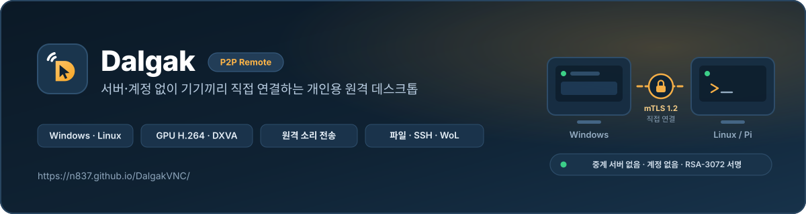
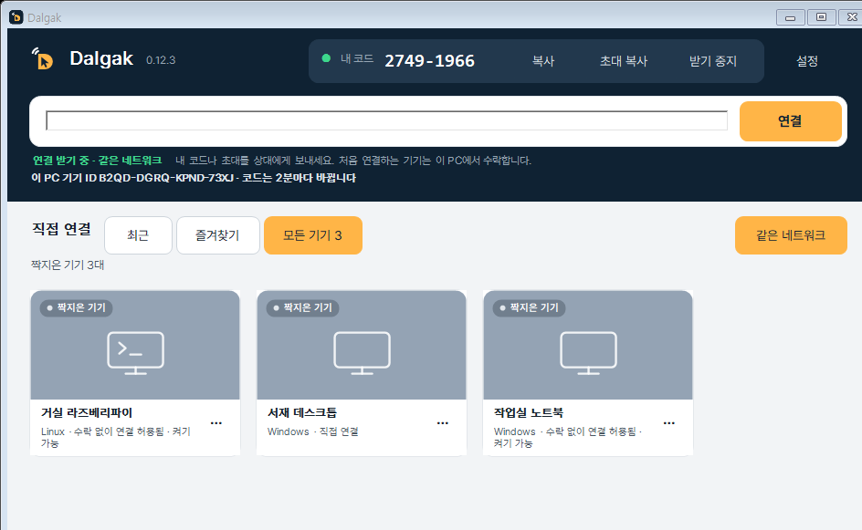
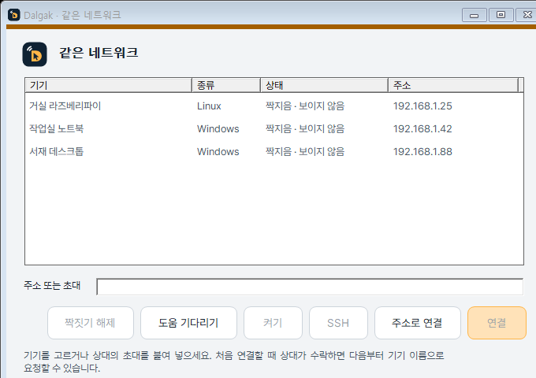
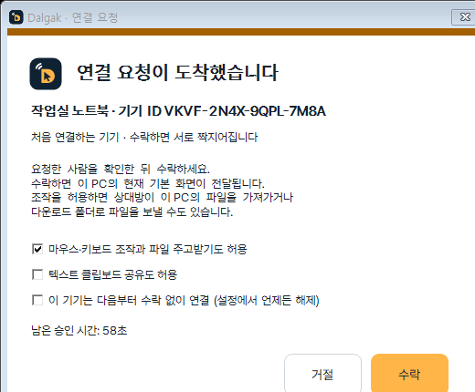
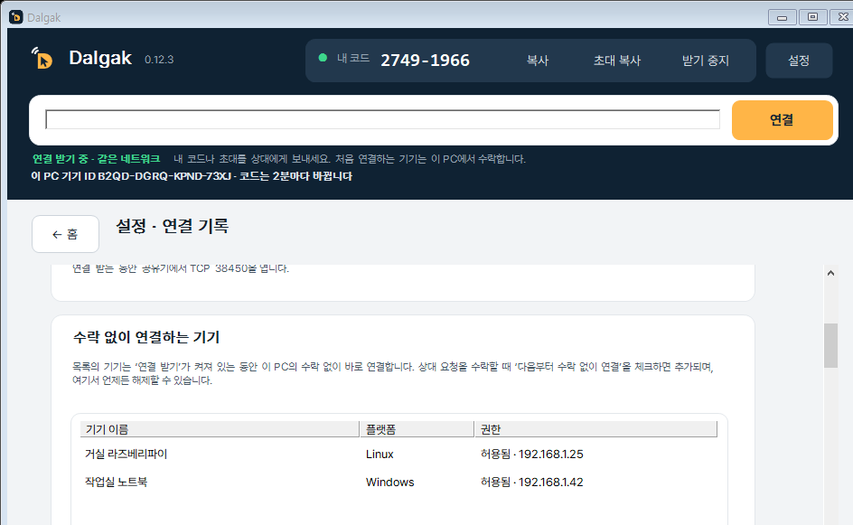
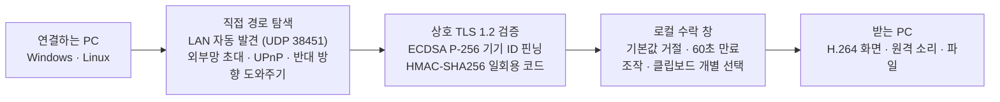

<p align="center">
  <a href="https://n837.github.io/DalgakVNC/">
    
  </a>
</p>

<p align="center">
  <a href="https://github.com/n837/DalgakVNC/releases/latest">
    
  </a>
  
  
  
</p>

<p align="center">
  <strong>중계 서버와 계정 없이, 기기끼리 직접 연결하는 개인용 P2P 원격 데스크톱</strong><br/>
  <a href="https://n837.github.io/DalgakVNC/"><strong>다운로드 페이지</strong></a> ·
  <a href="https://github.com/n837/DalgakVNC/releases/latest"><strong>최신 릴리스</strong></a> ·
  <a href="#앱-화면-미리보기">앱 화면 미리보기</a> ·
  <a href="#동작-구조">동작 구조</a> ·
  <a href="#보안-설계">보안 설계</a> ·
  <a href="#지원-환경-및-설치">설치 안내</a>
</p>

---

## 앱 화면 미리보기

<table>
  <tr>
    <td width="50%" valign="top">
      
      <p align="center"><strong>홈 화면 · 짝지은 기기 카드</strong><br/><sub>연결 받기 시작 시 일회용 코드·초대 문자열을 만들고, 짝지은 기기의 온라인 상태 확인과 원클릭 연결을 지원합니다.</sub></p>
    </td>
    <td width="50%" valign="top">
      
      <p align="center"><strong>같은 네트워크 자동 발견</strong><br/><sub>같은 Wi-Fi·공유기에 있는 Dalgak 기기를 자동으로 찾아 바로 연결, 원격 켜기(WoL), SSH 중계를 실행할 수 있습니다.</sub></p>
    </td>
  </tr>
  <tr>
    <td width="50%" valign="top">
      
      <p align="center"><strong>명시적 연결 요청 수락 창</strong><br/><sub>기본 선택은 <b>거절</b>이며 60초 뒤 자동 만료됩니다. 마우스·키보드·파일·클립보드 허용 범위를 매번 직접 선택합니다.</sub></p>
    </td>
    <td width="50%" valign="top">
      
      <p align="center"><strong>수락 없이 연결하는 기기 관리</strong><br/><sub>무인 접속을 허용한 기기를 기기 ID·마지막 주소와 함께 확인하고 언제든 한 번에 해제할 수 있습니다.</sub></p>
    </td>
  </tr>
</table>

> *위 스크린샷은 데모용 가상 기기 정보로 촬영한 실제 Windows 앱 화면입니다.*

---

## 동작 구조

화면·입력·파일·소리가 모두 기기 간 암호화 연결로 직접 오가며, 중앙 중계 서버나 계정을 거치지 않습니다.



---

## 한눈에 보는 주요 기능

| 영역 | 주요 기능 |
| --- | --- |
| **순수 P2P 연결** | • **같은 네트워크 자동 발견**: 같은 Wi-Fi·공유기의 Dalgak PC 자동 탐색(UDP `38451`)<br/>• **외부망 직접 연결**: 필요할 때만 UPnP / PCP / NAT-PMP 자동 포트 열기, IPv6, 일회용 초대 문자열(`dalgak://v1/...`) 지원<br/>• **반대 방향 도와주기**: CGNAT 등 포트가 막힌 PC를 도울 때 도와주는 쪽이 기다리고 상대 PC가 먼저 연결<br/>• **짝지은 기기 관리**: 홈 카드, 즐겨찾기, 온라인 배지, Wake-on-LAN(원격 켜기), SSH 중계 |
| **고속 화면 · 소리** | • **Windows 파이프라인**: DXGI Desktop Duplication, ContinuousUpdates, GPU H.264 인코딩, DXVA 하드웨어 디코딩, D3D11 SwapChain 직접 렌더링<br/>• **Linux 양방향 H.264**: `ffmpeg` / `libavcodec`·`libswscale` 감지 시 Windows ↔ Linux 양방향 H.264 자동 사용(미설치 시 Tight+JPEG 자동 폴백)<br/>• **원격 소리 전송**: Windows WASAPI 루프백 · Linux PipeWire/PulseAudio, IMA-ADPCM 4:1 압축 및 무음 억제(상단 **소리** 버튼, 기본 꺼짐) |
| **실사용 편의** | • **파일 주고받기**: 조작 허용 세션에서 파일 송수신(Windows 수신 파일 `Zone.Identifier` 자동 적용)<br/>• **선택적 클립보드 공유**: 수락 창에서 직접 체크한 경우에만 텍스트 클립보드 공유<br/>• **원클릭 자동 업데이트**: 앱 안에서 최신 버전을 확인하고 서명·해시 검증 후 바로 업데이트 |

---

## 보안 설계

| 항목 | 적용 방식 |
| --- | --- |
| **기기 인증서 핀닝** | 기기별 자체 ECDSA P-256 인증서를 생성해 DER SHA-256 해시를 기기 ID로 검증합니다. 개인키와 짝지은 기기 목록은 Windows DPAPI(`CurrentUser`) 및 Linux `0600` 권한으로 보호됩니다. |
| **일회용 코드 증명** | 평문 코드를 전송하지 않고 `HMAC-SHA256`으로 양측 기기 ID에 바인딩해 검증합니다. 코드는 2분(초대는 10분)마다 갱신되며, 5회 오입력 시 즉시 교체되고 반복 실패 IP는 일정 시간 차단됩니다. |
| **명시적 수락 · 최소 권한** | 수락 창의 기본 선택은 **거절**이며 60초 안에 수락하지 않으면 자동 만료됩니다. ‘수락 없이 연결’은 받는 PC에서 직접 허용한 기기에만 적용되며, 이 경우 클립보드 공유는 항상 차단됩니다. |
| **오프라인 서명 업데이트** | 자동 업데이트는 `n837/DalgakVNC` GitHub Releases만 허용하며, 오프라인 소유자 키의 **RSA-3072 + SHA-256** 서명과 파일 크기·해시가 모두 일치할 때만 설치합니다. |

> [!CAUTION]
> **안전 주의**: 전화나 메시지로 원격 연결 설치, 연결 코드 또는 초대 문자열 전달을 요구하는 낯선 사람에게는 절대 코드나 초대를 알려 주지 마세요. 연결 중에도 상단 바 또는 **받기 중지** 버튼으로 언제든 즉시 연결을 끊을 수 있습니다.

---

## 빠른 시작 (3단계)

1. **받는 PC**에서 **연결 받기 시작**을 누릅니다.
2. **연결하는 PC**에서 **같은 네트워크** 목록을 선택하거나, 상대가 보낸 **초대 문자열 / 주소 + 코드**를 입력해 **연결**을 누릅니다.
3. **받는 PC**에 뜬 요청 창에서 상대 기기 이름과 권한을 확인한 뒤 **수락**을 누릅니다.

---

## 지원 환경 및 설치

### Windows (x64 · .NET Framework 4.8 내장)
1. [다운로드 페이지](https://n837.github.io/DalgakVNC/)에서 **`Dalgak-Setup.exe`**(설치 파일) 또는 **`PersonalVnc.Windows.zip`**(무설치 포터블)을 받습니다.
2. 설치 파일은 현재 사용자 계정에 설치되며 관리자 권한을 요구하지 않습니다. (코드 서명이 없는 개인 배포 프로그램이므로 Windows SmartScreen 경고가 뜨면 게시 내용과 SHA-256을 확인한 뒤 실행하세요.)
3. 제거는 **Windows 설정 → 설치된 앱**에서 할 수 있습니다.

### Linux (Debian · Ubuntu · Raspberry Pi OS 등 GTK3 데스크톱)
1. [다운로드 페이지](https://n837.github.io/DalgakVNC/)에서 **`Dalgak.Linux.tar.gz`**를 받습니다.
2. 압축을 푼 뒤 설치 스크립트를 실행합니다.
   ```bash
   tar -xzf Dalgak.Linux.tar.gz
   cd dalgak-linux-*
   ./install.sh
   ```
3. 앱 메뉴의 **Dalgak** 또는 터미널에서 `dalgak`으로 실행합니다. 제거는 `~/.local/share/dalgak/uninstall.sh` 또는 앱 메뉴의 **Dalgak 제거**를 사용하세요.

---

## 약관 · 개인정보 · 오픈소스 고지

- [이용약관](https://n837.github.io/DalgakVNC/terms.html)
- [개인정보 처리방침](https://n837.github.io/DalgakVNC/privacy.html)
- [오픈소스 라이선스 고지](https://n837.github.io/DalgakVNC/licenses/)

---

## 저장소 및 저작권 안내

이 공개 저장소(`n837/DalgakVNC`)는 Dalgak의 공식 다운로드 페이지(GitHub Pages)와 릴리스 설치 파일(GitHub Releases) 배포 전용 저장소입니다. 소스 코드는 비공개로 관리됩니다.

Copyright (c) 2026 n837. All rights reserved.  
Dalgak은 개인 프로젝트이며, 저작권자의 사전 서면 허락 없이 이 소프트웨어의 복제·수정·재배포·판매를 금합니다. 포함된 제3자 오픈소스 구성 요소는 각자의 라이선스를 따릅니다.
